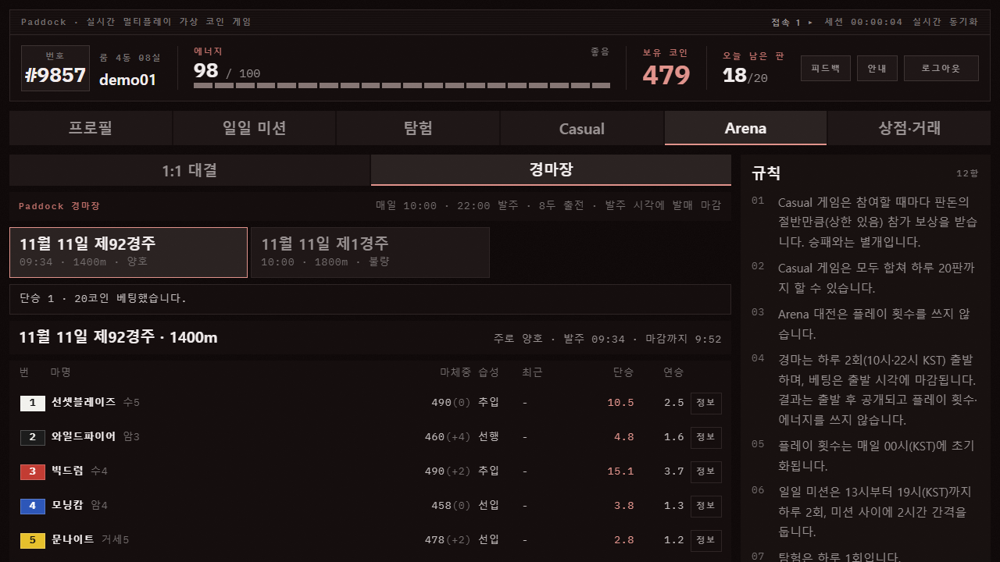
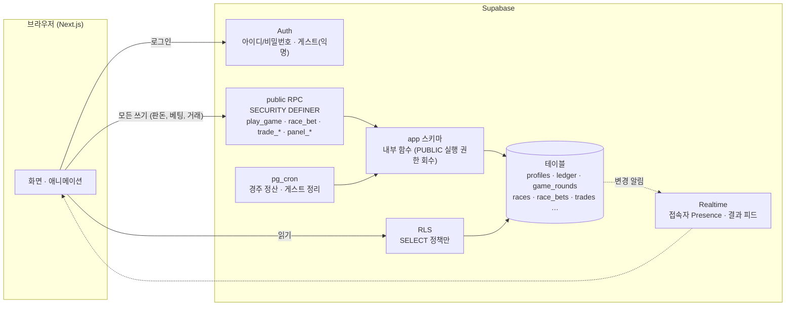

# Paddock

> **가상 코인 전용 · 현금 가치 없음 · 환전 불가.**
> Paddock의 코인은 게임 안에서만 쓰이는 가상 포인트입니다. 실제 돈으로 사거나 바꿀 수 없고, 어떤 형태의 상금도 없습니다.

약 30명 규모의 친구 커뮤니티에서 2개월간 실제로 운영한 실시간 멀티플레이 가상 코인 게임 플랫폼입니다.
난수·판정·정산을 모두 Postgres 함수에서 처리하고, 클라이언트는 아무것도 신뢰하지 않는 구조로 설계했습니다.


| 경마 출전표 | 경주 결과 | 캐주얼 · 룰렛 | 로그인 |
| --- | --- | --- | --- |
|  |  |  |  |

- **스택**: Next.js (App Router) · TypeScript · Tailwind CSS · Supabase (Postgres, RLS, Realtime, pg_cron, Storage) · Vercel
- **데모**: 배포 후 링크 추가 예정. 로그인 없이 게스트로 체험할 수 있습니다. 배포 절차는 [docs/deploy.md](docs/deploy.md)에 있습니다.

## 아키텍처



- **쓰기는 RPC로만 합니다.** 테이블에는 SELECT 정책만 있어서 브라우저가 코인이나 기록을 직접 바꿀 수 없습니다.
- **규칙 값의 정본은 서버입니다.** 배당표와 확률은 `get_rules()`가 내려주고, 화면은 같은 숫자를 따로 적어 두지 않습니다.
- **경마 결과는 발주 시각이 지난 뒤 정산 함수가 처음 만듭니다.** 정산은 cron과 첫 조회가 같이 맡고(lazy 정산), 행 잠금으로 몇 번 호출해도 한 번만 지급합니다.

## 주요 기능

- **경마**: 말 20두의 능력치 모델과 숨은 컨디션 5단계. 공개 정보로 몬테카를로 1,500회를 돌려 고정배당을 정합니다(공제율 20%). 단승·연승·복승을 지원하고, 10구간 스플릿 타임을 보간해 경주를 중계합니다. 인사이더 팁과 연습 경주도 있습니다.
- **서버 판정 4게임**: 룰렛(하우스 엣지 2.00%), 슬롯(1.91%), 하이로우(2.04%), 키노(RTP 약 0.98).
- **아레나**: 1:1 대전(주사위·인디언포커·블랙잭)과 라스트카드.
- **경제**: 개인 거래와 원장, 상점, 인벤토리, 일일 미션, 탐험과 고양이 이벤트.
- **운영**: 관리자 패널(계정 발급, 지급과 회수, 거래 취소), 피드백 게시판, 접속자 Presence, 실시간 결과 피드, KST 기준 일일 리셋.

## 케이스 스터디

| | 주제 |
| --- | --- |
| 1 | [클라이언트를 신뢰하지 않는 설계](docs/case-studies/01-zero-trust-client.md): RLS SELECT 전용, 그리고 실제로 뚫렸던 null 입력 |
| 2 | [경마: 정보 비대칭을 서버에서 지키기](docs/case-studies/02-race-information-asymmetry.md) |
| 3 | [정산 신뢰성: cron, lazy 정산, 화면과 정산의 분리](docs/case-studies/03-settlement-reliability.md) |
| 4 | [운영 사고에서 마이그레이션 구조로](docs/case-studies/04-ops-incident-and-migrations.md) |
| 5 | [경주 중계: React 바깥에서 프레임 그리기](docs/case-studies/05-race-replay-rendering.md) |
| 6 | [개인 거래와 원장](docs/case-studies/06-trade-and-ledger.md) |

운영 중 라이브 DB에 적용한 패치 가운데 14건을 [docs/ops-log.md](docs/ops-log.md)에 정리했습니다. 키노 환수율을 1.44에서 0.98로 보정한 과정과 RPC null 입력 취약점을 고친 과정이 들어 있습니다.

## 로컬 실행

필요한 것: Node.js 20+, Docker Desktop(실행 중).

```bash
npm install
npm run db:start                    # 로컬 Supabase(Postgres · Auth · Storage · Realtime) 기동
npm run db:reset                    # supabase/migrations 전부 + supabase/seed.sql 적용
cp .env.local.example .env.local    # 키는 npx supabase status 의 Publishable key
npm run dev
```

로컬 데모 계정은 `demo01` ~ `demo03` / `paddock-demo`, 관리자는 `admin` / `paddock-admin`입니다. seed.sql에 들어 있는 로컬 전용 값입니다.

DB는 [`supabase/migrations/`](supabase/migrations)에 도메인별로 나뉘어 있습니다(core · items · games · trade · arena · social · admin · race · rules · platform · guest). 같은 함수의 몸통은 한 파일에만 있고, 운영 DB 변경은 새 마이그레이션 파일로만 추가합니다.

## 테스트

```bash
npm run lint && npm run typecheck && npm run build
npm test                            # Vitest: 하우스 엣지, 하이로우 배율, 화면 문구
npx supabase test db                # pgTAP: 직접 수정 차단, 경마 기대값 · 결과 비노출 · 정산 1회, 거래 이중 지출, 게스트
npm run test:e2e                    # Playwright: 로그인 → 경마 베팅 → 결과, 게스트 체험
bash scripts/check-theme.sh         # 원본 콘셉트 용어 잔재 검사
```

GitHub Actions가 PR마다 위 검사를 모두 실행합니다. 단위 테스트 픽스처가 서버 `get_rules()`와 같은지도 함께 확인합니다.

## 용어와 DB 식별자

화면 용어와 DB 식별자가 다른 곳이 있습니다. 운영 원본의 스키마 이름을 유지했기 때문입니다.

| 화면 | DB 식별자 |
| --- | --- |
| 에너지 | `hp`, `hp_max`, `hp_at` |
| 휴식 쿨다운 | `ward_until` |
| 피드백 | `petitions`, `petition_messages` |

## 라이선스

[MIT](LICENSE)
