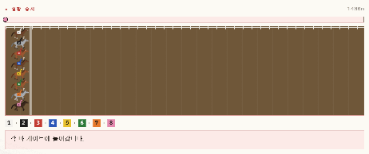
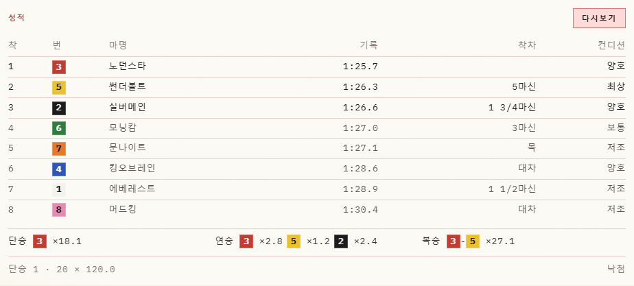
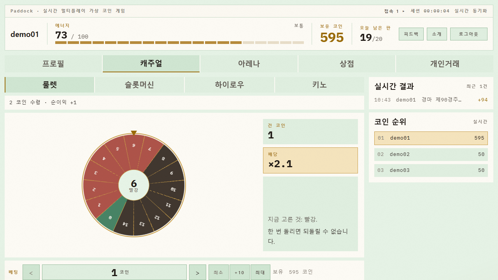
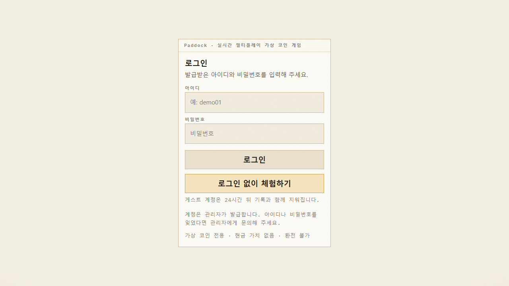
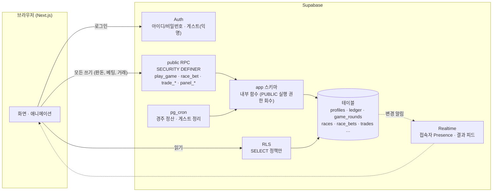

# Paddock

> **가상 코인 전용 · 현금 가치 없음 · 환전 불가.**
> Paddock의 코인은 게임 안에서만 쓰이는 가상 포인트입니다. 실제 돈으로 사거나 바꿀 수 없고, 어떤 형태의 상금도 없습니다.

실시간 멀티플레이 가상 코인 게임 플랫폼입니다.
약 30명 규모의 친구 커뮤니티에서 2개월간 실제로 운영한 서비스를, 포트폴리오로 공개하기 위해 간소화하고 다시 구성했습니다.
난수·판정·정산은 모두 Postgres 함수에서 처리하고, 클라이언트는 아무것도 신뢰하지 않는 구조로 설계했습니다.

**데모: [paddock-lemon.vercel.app](https://paddock-lemon.vercel.app)**: 로그인 화면의 "로그인 없이 체험하기"를 누르면 게스트로 바로 들어갈 수 있습니다.
무료 티어라 오래 접속이 없으면 DB가 잠시 멈춰 있을 수 있습니다.



| 경마 출전표 | 경주 결과 | 캐주얼 · 룰렛 | 로그인 |
| --- | --- | --- | --- |
|  |  |  |  |

## 한눈에 보기

| | |
| --- | --- |
| 역할 | 1인 개발. 기획, 프론트엔드, DB 설계, 배포, 운영을 모두 맡았습니다. |
| 운영 | 이용자 약 30명, 약 2개월. 운영 중 라이브 DB를 끄지 않고 계속 패치했습니다. |
| 재구성 | 2026년 11월. 운영본을 공개 가능한 형태로 정리하고 테스트와 CI를 붙였습니다. |
| 스택 | Next.js (App Router) · TypeScript · Tailwind CSS · Supabase (Postgres, RLS, Realtime, pg_cron, Storage) · Vercel |
| 테스트 | pgTAP(DB) · Vitest(단위) · Playwright(E2E) · GitHub Actions |

## 운영본에서 이 저장소로

운영본은 친구들끼리 쓰려고 만든 서비스라, 기능을 빠르게 붙이고 라이브 DB에 SQL 패치를 직접 적용하는 방식으로 굴러갔습니다.
운영본 저장소는 비공개로 두고, 이 저장소는 새 이력으로 시작해 아래처럼 정리했습니다.

- **설치를 두 줄로**: SQL 파일을 순서대로 붙여넣던 구조를 도메인별 Supabase 마이그레이션과 `seed.sql`로 나눴습니다. `supabase start`와 `supabase db reset`이면 로컬 환경이 그대로 올라옵니다.
- **규칙 값은 한 곳에만**: 서버와 클라이언트에 따로 적혀 어긋날 수 있던 배당표·확률을 서버의 `get_rules()` 하나로 모았습니다. CI가 단위 테스트 픽스처와 서버 값이 같은지 확인합니다.
- **같은 함수는 한 파일에만**: 운영 중 함수 몸통이 두 곳에 생겨 사고가 난 적이 있습니다([케이스 스터디 4](docs/case-studies/04-ops-incident-and-migrations.md)). 지금은 함수마다 마이그레이션 한 파일에만 몸통을 두고, DB 변경은 새 마이그레이션 파일로만 추가합니다.
- **큰 파일 분할**: 2천 줄이 넘던 화면 컴포넌트를 기능 단위로 나눴습니다.
- **테스트와 CI**: 운영 중에는 테스트가 거의 없었습니다. 운영에서 실제로 겪은 버그를 회귀 테스트로 먼저 고정했습니다.
- **게스트 체험**: 계정은 관리자가 발급하는 방식이라, 리뷰어가 바로 들어올 수 있도록 익명 게스트 계정을 추가했습니다. 게스트는 24시간 뒤 cron이 정리합니다.
- **범위 축소**: 운영본의 부가 콘텐츠와 특정 콘셉트에 묶인 요소는 빼고, 화면을 프로필 · 캐주얼 · 아레나 · 상점 · 개인거래 5개 탭으로 줄였습니다.

## 아키텍처



- **쓰기는 RPC로만 합니다.** 테이블에는 SELECT 정책만 있어서 브라우저가 코인이나 기록을 직접 바꿀 수 없습니다.
- **규칙 값의 정본은 서버입니다.** 배당표와 확률은 `get_rules()`가 내려주고, 화면은 같은 숫자를 따로 적어 두지 않습니다.
- **경마 결과는 발주 시각이 지난 뒤 정산 함수가 처음 만듭니다.** 정산은 cron과 첫 조회가 같이 맡고(lazy 정산), 행 잠금으로 몇 번 호출해도 한 번만 지급합니다.

**왜 로직을 앱 서버가 아니라 DB 함수에 두었나.** 판정과 코인 이동이 한 트랜잭션 안에서 끝나야 했고, 별도 서버 없이 Supabase만으로 운영하고 싶었습니다. 원자성과 우회 차단은 얻었지만 테스트와 디버깅이 어려워졌고, 그래서 pgTAP 테스트를 따로 갖췄습니다.

## 주요 기능

- **경마**: 말 20두의 능력치 모델과 숨은 컨디션 5단계. 공개 정보로 몬테카를로 1,500회를 돌려 고정배당을 정합니다(공제율 20%). 단승·연승·복승을 지원하고, 10구간 스플릿 타임을 보간해 경주를 중계합니다. 인사이더 팁이 있고, 정식 경주(하루 두 번) 밖에서도 볼 수 있는 연습 경주가 있습니다.
- **캐주얼, 서버 판정 4게임**: 룰렛(하우스 엣지 2.00%), 슬롯(1.91%), 하이로우(2.04%), 키노(RTP 약 0.98).
- **아레나**: 1:1 대전(주사위 · 인디언포커 · 블랙잭).
- **경제**: 개인거래와 원장, 상점과 인벤토리, 에너지와 휴식 쿨다운.
- **운영**: 관리자 패널(계정 발급, 지급과 회수, 거래 취소), 피드백 게시판, 접속자 Presence, 실시간 결과 피드, KST 기준 일일 리셋.

## 기술적 도전 (케이스 스터디)

| | 주제 | 결과 |
| --- | --- | --- |
| 1 | [클라이언트를 신뢰하지 않는 설계](docs/case-studies/01-zero-trust-client.md) | RLS를 SELECT 전용으로 두었습니다. 운영 중 RPC null 입력으로 실제로 뚫렸던 경로를 막고 pgTAP으로 고정했습니다. |
| 2 | [경마: 정보 비대칭을 서버에서 지키기](docs/case-studies/02-race-information-asymmetry.md) | 마감 전에는 결과가 어디에도 존재하지 않습니다. 배당 기대값이 `1 − 공제율`에 수렴하는지 테스트합니다. |
| 3 | [정산 신뢰성: cron, lazy 정산, 화면과 정산의 분리](docs/case-studies/03-settlement-reliability.md) | 애니메이션이 끊겨도 정산은 끝까지 흘러가고, 정산 함수는 몇 번을 불러도 한 번만 지급합니다. |
| 4 | [운영 사고에서 마이그레이션 구조로](docs/case-studies/04-ops-incident-and-migrations.md) | 함수 몸통 중복으로 생긴 사고를 계기로 마이그레이션 구조로 옮겼습니다. |
| 5 | [경주 중계: React 바깥에서 프레임 그리기](docs/case-studies/05-race-replay-rendering.md) | 프레임마다 ref로 DOM을 직접 갱신하고, React는 구간이 바뀔 때만 다시 그립니다. |
| 6 | [개인거래와 원장](docs/case-studies/06-trade-and-ledger.md) | 성사 순간 두 사람의 행을 id 순으로 잠그고 잔액을 다시 확인해 이중 지출을 막습니다. |

운영 중 라이브 DB에 적용한 패치 가운데 14건을 [docs/ops-log.md](docs/ops-log.md)에 정리했습니다. 키노 환수율을 1.44에서 0.98로 보정한 과정과 RPC null 입력 취약점을 고친 과정이 들어 있습니다.

## 한계와 배운 점

- **규모**: 실제 이용자는 약 30명이었습니다. 소규모 실사용 환경에서 정확성과 운영 안정성은 확인했지만, 확장성은 검증하지 않았습니다. 접속자가 크게 늘면 폴링 훅과 cron 정산이 먼저 병목이 될 것으로 봅니다.
- **처음부터 잘 만든 구조는 아닙니다**: 초기에는 SQL이 한 파일에 수천 줄로 커졌고, 컴포넌트도 비대했고, 테스트는 나중에 붙었습니다. 운영하면서 생긴 사고와 버그를 계기로 이 저장소의 구조(마이그레이션, 규칙 일원화, 회귀 테스트)로 고쳐 왔습니다.
- **DB 함수 중심 설계의 비용**: 로직이 SQL에 있어서 타입 안전성과 디버깅 도구가 부족합니다. pgTAP 테스트와 "함수 몸통은 한 파일에만" 규칙으로 보완하고 있습니다.

## 로컬 실행

필요한 것: Node.js 20+, Docker Desktop(실행 중).

```bash
npm install
npm run db:start                    # 로컬 Supabase(Postgres · Auth · Storage · Realtime) 기동
npm run db:reset                    # supabase/migrations 전부 + supabase/seed.sql 적용
cp .env.local.example .env.local    # 키는 npx supabase status 의 Publishable key
npm run dev
```

로컬 데모 계정은 `demo01` ~ `demo03` / `paddock-demo`, 관리자는 `admin` / `paddock-admin`입니다. seed.sql에 들어 있는 로컬 전용 값입니다.

DB는 [`supabase/migrations/`](supabase/migrations)에 도메인별로 나뉘어 있습니다(core · items · games · trade · arena · social · admin · race · rules · platform · guest). 배포 절차는 [docs/deploy.md](docs/deploy.md)에 있습니다.

## 테스트

```bash
npm run lint && npm run typecheck && npm run build
npm test                            # Vitest: 하우스 엣지, 하이로우 배율, 화면 문구
npx supabase test db                # pgTAP: 직접 수정 차단, 경마 기대값 · 결과 비노출 · 정산 1회, 거래 이중 지출, 게스트
npm run test:e2e                    # Playwright: 로그인 → 경마 베팅 → 결과, 게스트 체험
bash scripts/check-theme.sh         # 운영본 콘셉트 용어 잔재 검사
```

GitHub Actions가 PR마다 위 검사를 모두 실행합니다. 단위 테스트 픽스처가 서버 `get_rules()`와 같은지도 함께 확인합니다.

## 용어와 DB 식별자

화면 용어와 DB 식별자가 다른 곳이 있습니다. 운영본의 스키마 이름을 유지했기 때문입니다.

| 화면 | DB 식별자 |
| --- | --- |
| 에너지 | `hp`, `hp_max`, `hp_at` |
| 휴식 쿨다운 | `ward_until` |
| 피드백 | `petitions`, `petition_messages` |

## 라이선스

[MIT](LICENSE)
