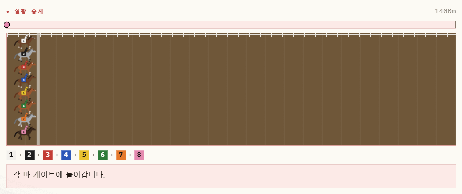

# 5. 경주 중계: React 바깥에서 프레임 그리기

## 문제

경주 중계에서는 출전마 8두가 약 25초 동안 달린다. 말마다 위치, 스프라이트 프레임, 카메라 위치가 매 프레임 바뀐다. 이 값들을 React state에 두면 초당 60번씩 중계 컴포넌트 전체가 다시 렌더링된다. 휴대폰에서도 중계가 매끄럽게 보여야 했다.

## 결정

코드는 [`src/components/race/RaceTrack.tsx`](../../src/components/race/RaceTrack.tsx)에 있다.

**서버가 준 데이터만 보간한다**
- 정산할 때 서버가 말마다 10구간 누적 타임(`result.splits`)을 남긴다.
- 클라이언트는 경과 시간으로 각 말이 몇 번째 구간에 있는지 찾고, 위치를 보간해 그린다.
- 클라이언트에는 난수가 없다. 그래서 몇 번을 다시 봐도 같은 중계가 나온다.

**프레임마다 바뀌는 값은 ref로 DOM을 직접 고친다**
- `requestAnimationFrame` 루프 하나가 말 요소의 `transform`, `left`, `background-position`만 ref로 직접 바꾼다. React 렌더링을 거치지 않는다.
- 레이아웃을 다시 계산하게 만드는 속성은 피했다.

**React는 구간마다 한 번만 다시 그린다**
- 자막(중계 멘트)과 현재 순위는 구간이 바뀔 때만 state를 갱신한다. 그래서 React 렌더링은 한 경주에 10여 번뿐이다.

**카메라와 미니맵**
- 카메라는 선두 말을 화면 2/3 지점에 두고 따라간다.
- 뒤처진 말은 화면 밖으로 빠지고, 위쪽 미니맵이 전체 간격을 보여 준다.

## 결과

- 프레임마다 하는 일은 말 8두의 스타일 값 몇 개를 고치는 것뿐이다. React 렌더링은 구간이 바뀔 때만 일어난다.
- 중계 연출은 정산과 무관하다. 결과는 중계가 시작되기 전에 이미 서버에 확정돼 있다. 중계 도중 화면을 벗어나도 잔액은 이미 맞다([케이스 스터디 3](03-settlement-reliability.md)).
- 시연 GIF는 Playwright 캡처 설정(`playwright.capture.config.ts`)으로 다시 만들 수 있다.

## 한계와 다음에 한다면

- 지금은 DOM 요소를 움직이는 방식이다. 출전마가 수십 두로 늘거나 이펙트를 더하려면 Canvas가 더 낫다.
- 프레임 시간을 계측한 수치는 남기지 못했다. 다음에는 Performance API로 저사양 기기의 프레임 드롭을 측정해 개선 전후를 비교하겠다.
